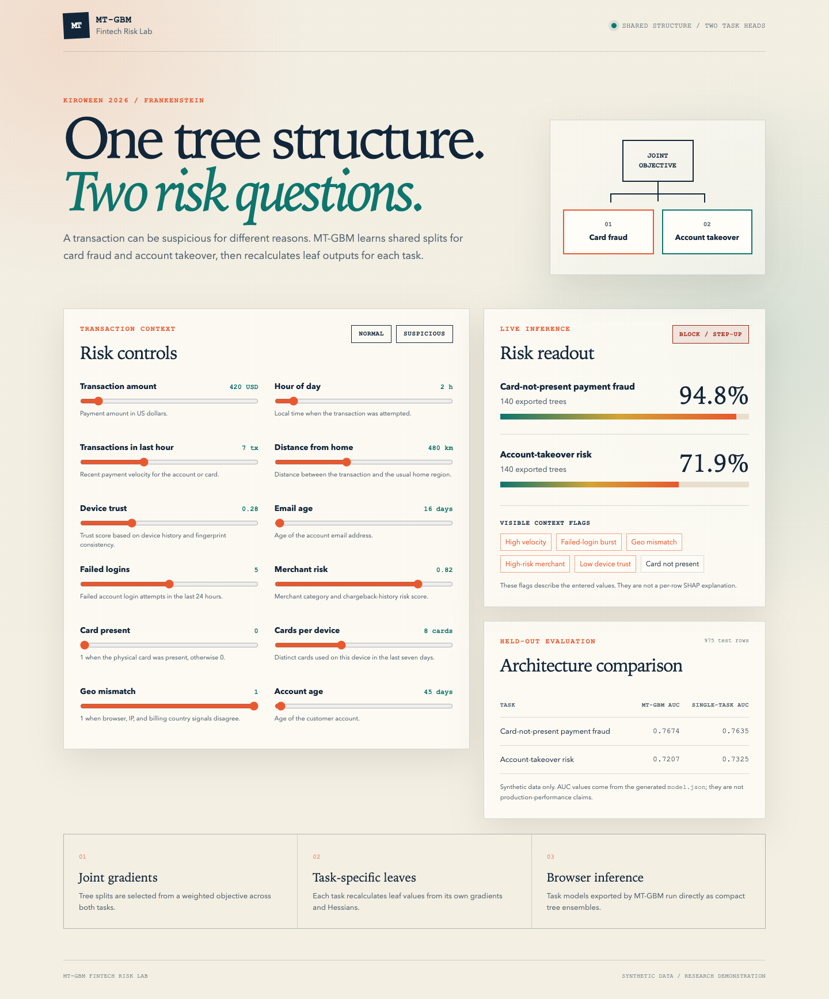

# MT-GBM: Multi-Task LightGBM for Fintech Risk

MT-GBM is a LightGBM 3.3.2.99 branch that learns a shared tree structure across
multiple labels and recalculates leaf outputs for each task. The included
fintech demo applies the idea to two related questions:

- Card-not-present payment fraud.
- Account-takeover risk.

The project was developed with Kiro as an agentic development environment. Its
project-specific agent, steering, hooks, and spec are committed under
[`.kiro`](.kiro).



## What is different

Standard gradient boosting trains one objective at a time. MT-GBM adds a
single-machine multi-task path that:

1. Accepts a label matrix through the `num_labels` parameter.
2. Uses joint gradients and Hessians to learn shared tree splits.
3. Recalculates task-specific leaf values with each task's gradients and
   Hessians.
4. Uses the `serial2` tree learner for the shared-structure path.
5. Exposes `Booster.save_model2()` for task-specific model export.

The implementation spans the C++ core, C API, Python package, model
serialization, and examples.

## Fintech demo

The demo generates deterministic synthetic transaction data and trains:

- Two independent single-task LightGBM baselines.
- One MT-GBM model with shared structure across both tasks.

The generated static site runs the exported MT-GBM trees directly in JavaScript.
No customer data or hosted Python backend is required.

Current held-out results from the reproducible synthetic dataset:

| Task | MT-GBM AUC | Single-task AUC |
| --- | ---: | ---: |
| Card-not-present fraud | 0.7674 | 0.7635 |
| Account takeover | 0.7207 | 0.7325 |

These are synthetic research results, not production-performance claims.

Run the demo locally:

```bash
PYTHONPATH=python-package python3 demo/train_export.py
python3 -m http.server 8000 --directory demo/web
```

Then open `http://localhost:8000`.

## Build

### macOS

The build requires CMake, a C++ compiler, and OpenMP:

```bash
brew install cmake libomp
cmake -S . -B build \
  -DCMAKE_BUILD_TYPE=Release \
  -DCMAKE_POLICY_VERSION_MINIMUM=3.5 \
  -DOpenMP_C_FLAGS="-Xpreprocessor -fopenmp -I/opt/homebrew/opt/libomp/include" \
  -DOpenMP_CXX_FLAGS="-Xpreprocessor -fopenmp -I/opt/homebrew/opt/libomp/include" \
  -DOpenMP_C_LIB_NAMES=omp \
  -DOpenMP_CXX_LIB_NAMES=omp \
  -DOpenMP_omp_LIBRARY=/opt/homebrew/opt/libomp/lib/libomp.dylib
cmake --build build -j
```

### Linux

```bash
cmake -S . -B build -DCMAKE_BUILD_TYPE=Release
cmake --build build -j
```

Use the local Python package with:

```bash
PYTHONPATH=python-package python3 -c "import lightgbm; print(lightgbm.__file__)"
```

The fork retains LightGBM's original package APIs. In this branch, call
`Booster.set_num_labels(...)` before prediction when using the MT-GBM path.

## Kiro usage

The repository includes:

- `.kiro/agents/mtgbm-engineer.json`: a project-scoped custom agent.
- `.kiro/steering/`: persistent product, architecture, development, and testing
  context.
- `.kiro/hooks/`: automatic Python compilation and multi-task regression-review
  prompts.
- `.kiro/specs/multi-task-boosting/`: requirements, design, and implementation
  tracking for the multi-task feature.

## Examples

- `examples/multitask/example1/`: two-label time-series amount prediction.
- `examples/multitask/example2/`: IEEE-CIS fraud example with auxiliary labels.
- `demo/`: reproducible synthetic fintech demo and browser interface.

## Originality and disclosure

MT-GBM builds on the open-source LightGBM project at version 3.3.2.99 under the
MIT license. Standard LightGBM source code is pre-existing upstream work and is
not claimed as new. The multi-task extension, Kiro project context, and fintech
demo are documented in this repository. See
[`UPSTREAM_README.md`](UPSTREAM_README.md) for the original LightGBM README.

## Limitations

- Multi-task training is limited to the single-machine `serial2` learner.
- The demo uses synthetic data.
- The project is not a production fraud decision system.
- Production use would require security, monitoring, fairness review, audit
  logging, analyst workflows, and model-risk governance.

## License

The repository retains the LightGBM MIT license. See [`LICENSE`](LICENSE).
